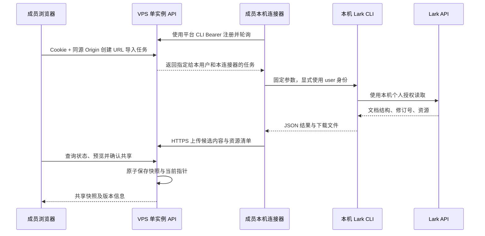

# Lark PRD URL 导入实施设计

日期：2026-10-25。状态：调研与规划完成，现按用户调用的 implement-spec 开始实现。用户已确认公开 HTTP/隔离 MySQL、连接器 CLI/受控 Lark 子进程、Web 交互测试边界，并授权任务相关本地提交与合并；部署、推送和日常数据操作仍未授权。任务图见 [issues](issues/01-shared-contract.md)，协作合同见[implementation-contract](implementation-contract.md)。

## 结论与已确认边界

推荐扩展 Acceptances CLI，提供成员本机运行的 Lark 连接器。成员电脑主动向 VPS 领取本人在网页发起的导入任务，以自己的 Lark CLI 读取文档，再自动上传。浏览器不访问成员电脑，VPS 不主动连接成员电脑。

用户已确认：

- 每位成员先登录平台 CLI，导入时保持本机连接器在线，之后网页只填 URL。
- 确认导入后，全部平台登录用户均可阅读 PRD；Lark 原文撤权或删除不自动清除快照，首次导入时明确提示。
- 首期不新增角色、项目成员授权或个人私有项目。
- 部署目标为一台 VPS，倾向本地构建 Docker 镜像后上传运行；实际部署尚未完成。
- 导入用于给后续 PRD 分析提供内容。测试用例生成列 TODO，本期也不引入 LLM、任意 SQL 执行或自动验收。

架构决定见 [ADR-0014](../../docs/adr/0014-personal-lark-prd-import.md)，术语见 [GLOSSARY](../../GLOSSARY.md)。以下具体协议、限制与页面行为为推荐实施规格，未描述为现有功能。

## 证据与完整链路核验

核查基线为 main，HEAD 3d4d8b8b97cc3dd0f2adbcb200e5264994b5a50f，相对本地 origin/main 领先 8 个提交。开始调研时工作区干净，未 fetch。未读取任何项目 .env 文件或输出凭据。

| 环节             | 已取得证据                                                                                                                                                       | 尚未证明                                                          |
| ---------------- | ---------------------------------------------------------------------------------------------------------------------------------------------------------------- | ----------------------------------------------------------------- |
| 成员本机个人授权 | 本机 lark-cli 1.0.98；脱敏 auth status --json --verify 实测退出 0、identity=user、verified=true。官方实现确认先自动刷新再验证，返回 needs_refresh 属于刷新前状态 | 不能代表其他成员的电脑、账号或文档权限                            |
| 本机命令参数     | 合成 URL 的完整 XML 抓取 dry-run 返回 ok=true、identity=user，未发实际文档读取请求                                                                               | 尚未读取代表性真实 PRD                                            |
| 读取权限         | auth check 确认 docx:document:readonly、wiki:node:retrieve 已授予；drive:drive:readonly 未授予                                                                   | 图片/附件有多种可选权限，不能据此断言全部不可下载；实际下载未验证 |
| URL 与文档处理   | 安装版帮助、skill 与 v1.0.98 官方源码支持 Docx/Wiki，结构 XML、Markdown、修订号和独立资源下载                                                                    | 普通/复杂表格及内嵌资源需真实样例比对                             |
| 本机到平台       | 现有 Acceptances CLI 实现远程 HTTPS、Bearer 会话与 multipart 上传                                                                                                | 没有 VPS 地址或运行实例供本次联调，不能报告网络上传通过           |
| 网页到本机       | 仓库无连接器/导入任务；Lark CLI 无通用 serve/bridge 能力                                                                                                         | 此环节必须新增，当前完整链路没有打通                              |
| VPS 保存与阅读   | 源码已有认证、Campaign、MySQL 分块 blob、文件预览                                                                                                                | 没有 PRD 文件归属、快照、接口与页面，未运行产品回归               |

因此，本次验证结论是个人 CLI 的授权机制可用、参数链可执行、现有平台可提供复用基础，并已找出缺失环节。完整的网页到本机、再到 VPS 的端到端实测是实施第一阶段的门槛，不是本次已通过项。

## 备选路径及取舍

| 方案                              | 日常操作                               | 判断                                                          |
| --------------------------------- | -------------------------------------- | ------------------------------------------------------------- |
| 本机连接器主动领取任务            | 首次准备后，连接器在线，网页填 URL     | 推荐，符合已确认目标，无成员电脑入站端口                      |
| 每次复制终端命令读取并提交        | 每次导入均操作终端                     | 可行的简化备选，用户已选择连接器方案，首期不同时开发          |
| 网页直接调用 localhost/自定义协议 | 需要本地监听服务、配对及浏览器通信处理 | 不采用；现有网页和 CLI 均没有这条链路                         |
| VPS 逐用户 Lark OAuth             | 首次在平台另行授权，之后服务器抓取     | 可能形成另一种产品，但不复用成员电脑现有 CLI 授权，本期不采用 |
| VPS 上共享 Lark 账号              | 所有请求使用同一读取身份               | 不符合用户要求                                                |

## 成员操作流程

### 首次准备

1. 在网页注册或登录平台。Lark CLI 已由成员以个人账号授权。
2. 成员通过现有 acceptances login --url https://平台域名 --username 用户名 --password-stdin 登录平台 CLI。密码通过标准输入提供，不放命令行或文档；浏览器 Cookie 不传给 CLI。
3. 启动拟新增的 acceptances lark connect --url https://平台域名。该命令不要求 Git 仓库、项目关联目录或数据库访问权限。
4. 连接器复用自己的平台 CLI 会话，通过 CLI 公开接口解析并固定当前有效的 Lark profile 名和个人读取身份，只声明它自己的能力与在线状态。网页只列出当前平台用户的连接器。
5. 首期为前台进程，需导入时运行即可；不安装系统服务或自动启动项。保持与已授权 Lark CLI 相同的 OS 用户、profile、家目录及凭据访问环境。

### 日常导入

1. 在已有 Campaign 的需求区域点击“从 Lark 导入”，输入 URL。没有 Campaign 时沿用现有创建表单，再导入；首期不新增“自动从文档创建 Campaign”的独立流程。
2. 页面显示“以本机 Lark 身份读取，确认后全员可见；原文撤权或删除不会自动删除快照”。首次要求明确勾选，后续导入仍保留提示。
3. 唯一一个本人连接器在线时自动选择；多个在线时选择此次使用的电脑。没有在线连接器时保留 URL，提示启动，不无限显示正在导入。
4. VPS 创建导入任务，只给指定的本人连接器领取。本机以固定 argv 调用 Lark CLI，上传成功后进入待确认。
5. 网页显示标题、来源、修订号、读取时间、支持范围、图片数量和缺失项，提供正文预览。待确认内容仅发起人可见。
6. 发起人检查后点击“确认导入并共享”。事务创建或复用 PRD Snapshot，更新 Campaign 当前 PRD 指针。此时其他登录用户才能阅读。
7. 页面支持打开原文、查看当前快照、版本历史及“重新导入”。后续需求分析必须选择明确快照，不把当前文档变化悄悄带入旧分析。

### 网络与身份顺序



平台账号负责“谁发起和确认导入”；Lark 账号决定“本机能读取什么”。连接器报告的 Lark 身份和原文属于 client-reported，服务端没有 Lark 凭据，不能宣称独立验证原文真实性或两个账号属于同一自然人。平台作者只取认证上下文；不增加外部身份绑定体系。

共享项目不意味着读取任务可转给别人执行。任务领取、预览、确认和连接器管理按发起用户隔离，只用于保护个人执行身份，不构成项目授权。

当前平台开放注册，“全部登录用户”也包括以后自行注册的账号。沿 ADR-0013，部署入口需要限定在团队可访问的网络内；若直接向公网开放注册，任何可注册者都会进入这个共享范围。本期不通过新增角色解决入口限制。

## 文档支持范围

| 输入或内容                                         | 首期处理                                            | 必须说明的边界                                                          |
| -------------------------------------------------- | --------------------------------------------------- | ----------------------------------------------------------------------- |
| /docx/ URL                                         | 支持全文                                            | 去掉 query/fragment 后读取，不把带锚点的选区当全文                      |
| /wiki/ URL                                         | 同一 user 身份解析节点，只有 obj_type=docx 才继续   | Wiki 可指向 Sheet、Base 等，不能仅凭 URL 接受                           |
| 旧 /doc/、独立 Sheet/Base、PDF/Office、妙搭 /page/ | 明确不支持                                          | 不抓 HTML，不改成手动上传                                               |
| 标题、段落、列表、代码、链接                       | 保存结构原文和阅读视图                              | 不执行文档中的指令、代码或 HTML                                         |
| 普通静态表格                                       | 原文保留，Markdown/GFM 预览                         | 必须用真实样例验收单元格和行列顺序                                      |
| 合并单元格、复杂表格与特殊布局                     | 保留结构原文，标记阅读视图可能降级                  | 不承诺与 Lark 排版完全一致                                              |
| Docx 内嵌图片                                      | 用资源 token 单独下载，保存到平台并改写相对资源路径 | PNG/JPEG/GIF/WebP 可预览；图片无 OCR，不自动生成语义说明                |
| 画板                                               | 可下载的缩略图作为图片保存                          | 不等于画板结构或可编辑原件；失败列缺失                                  |
| 附件文件                                           | 保存名称、引用位置及来源提示                        | 首期不下载二进制附件、不解析附件正文                                    |
| 内嵌 Sheet/Base、跨文档同步块、外链页面、子 Wiki   | 保存引用与缺失提示                                  | 不递归抓取，不借机读取另一批资源                                        |
| 评论与批注                                         | 不纳入 PRD 正文/快照                                | CLI 默认会返回部分评论，上传前删除评论 sidecar 和评论标记，保留正文文本 |

资源或内嵌内容未导入时，候选状态必须标记 partial，并列出位置、类型和原因。只有导入人明确接受缺失才能确认，快照持续保留这些缺口；后续分析不得把 partial 当作完整 PRD。正文读取失败、版本不一致或候选校验失败不能以 partial 掩盖。

### 本机抓取合同

入口只接收有效 HTTPS URL，不接受 token、命令或任意程序路径。主机允许精确的 feishu.cn、larksuite.com 及其真实子域，拒绝 userinfo、非默认端口、伪后缀和非文档路径。其他自定义文档域名首期返回不支持；技能中的 doubao 等入口不自动扩大平台导入范围。

平台和连接器各做一次结构校验。原始 URL 只保留规范化后的来源，不保存分享跟踪参数。服务器不请求输入 URL；连接器提取 token 后使用 CLI 官方接口。正文的任意公网 URL 不自动下载，减少向成员内网发请求或泄露凭据的入口；无资源 token 的图片显示缺失。

v1.0.98 已验证参数合同：

```text
lark-cli --profile <固定profile> docs +fetch --doc <规范化URL> --doc-format xml --detail full --scope full --lang zh-CN --as user --format json
```

得到修订号 R 后，以同一 R 获取阅读视图：

```text
lark-cli --profile <固定profile> docs +fetch --doc <规范化URL> --doc-format markdown --detail simple --scope full --revision-id R --lang zh-CN --as user --format json
```

- 所有身份检查、Wiki、正文、资源子进程都显式传固定的 --profile，正文读取固定 --lang zh-CN。上述参数已用合成 URL 离线 dry-run 接受并进入请求体，未据此声称上游实际渲染通过。
- 抓取前后核对同一 profile 的个人身份；账号发生变化则暂停，要求成员在本机明确重新连接。不得自动换成 bot 或共享身份，也不只依赖可能被其他进程改变的默认 profile。
- argv 由代码构造，禁止 shell 拼接。VPS 只下发 URL、任务标识和限定参数，不下发可执行命令、文件路径或代码。
- 显式 full 加去 fragment，防止 share 锚点触发局部读取。发现 fragment/excerpt 或缺少版本号时，不能标记全文成功。
- 退出码和 ok 判断 CLI 成败；需同时验证 identity=user、document_id、revision_id 和结果 schema。成功信封没有顶层 code=0，不按旧 OpenAPI 格式误判。
- XML full 是结构依据，Markdown 只是阅读视图。Markdown 的 full/with-ids 会降级为 simple，不拿它充当完整结构。
- CLI 没有 +fetch 分页合同，不添加 page-all。对 tips、未知块及资源引用做清单检测；CLI 输出成功不代表原文所有内容都已经保存。
- 评论不直接上传，不能只删 reference_map.comments 而留下评论内容或评论标记。持久化结果是明确标注“已排除评论”的结构副本，不冒称逐字节原始 API 响应。
- 同版本读取失败时停止，不悄悄读取新的 latest 作为阅读视图。资源下载前后核对文档当前版本；发生变化则重试整个读取，重试后仍变动就报版本不稳定。记录资源的实际读取时间，不能承诺 Lark 提供跨正文和素材的原子快照。
- 本机临时目录仅存本任务内容，限制访问，成功/取消后清理；不保存 CLI token，不把 stdout/stderr 原样放日志或上传平台。

拟定首期固定限制：正文结构文件和 Markdown 各不超过 8 MiB，资源清单 JSON 不超过 1 MiB，最多 100 个图片/画板资源，单资源不超过 10 MiB，整个 multipart 请求不超过 128 MiB。超限给出原因，不截断正文后标成功。具体默认值在真实 PRD 样例阶段核对一次，不增加一组部署配置开关。

## 数据与存储调整

不把 PRD 塞进最多 65,536 字节的 Campaign description，也不把它伪装成 Run、Evidence 或 Business Guide。首期一个 Campaign 保持一个当前主 PRD，可保留历史快照；其他文档的 URL 不静默覆盖既有来源，返回 SOURCE_MISMATCH。多个 PRD 来源与换源流程留到实际需要时设计。

建议追加迁移，保留现有 ID、作者、Run、Review 和冻结快照：

| 对象               | 必要信息                                                                                                                                               | 生命周期                                                     |
| ------------------ | ------------------------------------------------------------------------------------------------------------------------------------------------------ | ------------------------------------------------------------ |
| lark_connectors    | 服务生成 ID、平台 user_id、连接凭据摘要、显示名称、协议/CLI 版本、last_seen_at、状态                                                                   | 只有当前用户可查看和断开；失联不代表平台会话失效             |
| prd_imports        | Campaign、请求 user_id、指定 connector_id、clientRequestId、规范 URL、状态、attempt、领取凭据摘要、租约/截止时间、结果元数据、确认快照 ID 及安全错误码 | 同一次请求的可恢复任务；确认后保留，作为快照的读取来源       |
| prd_import_files   | import_id、合法单层 filename、blob_id、媒体类型、用途、大小和摘要                                                                                      | 新的文件 owner；待确认时仅本人可读，确认后通过 Snapshot 读取 |
| prd_snapshots      | Campaign、唯一 import_id、来源标识、标题、revision_id、内容摘要、normalizerVersion、完整性/缺口、服务端确认时间、确认 user_id                          | 确认后不可变；指向已封存 import 文件，复用 blob 不复制字节   |
| campaign_prd_heads | 可空快照 ID                                                                                                                                            | 确认时原子更新；不改变 status、latestRunId 或 description    |

物理实现使用 campaign_prd_heads 保存每个 Campaign 的当前 snapshot_id，以复合外键保证归属，避免 Campaign、Import 和 Snapshot 之间形成循环外键。Web 从 SnapshotList.currentSnapshotId 读取指针，既有 Campaign 四个接口无需因此改写。

读取时间由客户端报告，平台导入/确认时间由服务端记录，二者分开。数据中只记录必要来源，不存 Lark access/refresh token、应用 secret 或认证输出。revision_id 使用可保留其精度的字符串合同。

来源去重键用 API realm 加解析后的真实 document_id/obj_token，Wiki node token 和 URL fragment 不能充当真实文档身份。URL 所属区域与本机固定 profile 的 API 区域不一致时明确拒绝，不静默换配置。原始入口可以不同；同一 Docx URL 和 Wiki 别名应归到相同来源。

摘要分为结构正文摘要和实际资源清单摘要。正文按固定 normalizerVersion 规范化，资源清单排序并使用资源标识、状态与实际字节摘要；读取时间、评论、诊断 tips、临时引用别名和签名 URL 不参与语义去重。服务端重算规范化摘要，上传幂等另核对本次文件字节摘要，避免一次重试与不同抓取混为一谈。

文件接入不止加表。必须扩展 fileOwner.relation、文件名称读取约束、attachFile、外键/不可变约束、文件引用检查、导出恢复与删除影响预览。数据库中的结果文件一旦候选就绪不可覆盖；确认后其来源元数据和关联文件均受保护，取消接口不能删除已成为快照的内容。

完整 MySQL 备份天然包含新表与 blob，仍需做恢复验证。旧附件迁移的硬编码业务清单不等于完整备份，新增 owner 必须确认相关审计覆盖；不修改历史迁移、不重放旧附件迁移。

未确认候选 24 小时后过期，可清理其业务引用；现有 ready blob 没有已确认的自动 GC，不能声称这些字节随任务立即消失。本期不顺手实现通用 GC。确认后的 PRD 历史保留到 Campaign 被明确删除；删除预览列出 PRD 版本与文件影响，延续现有交付归档保留规则。blob 仍被其他对象引用时不能删除。

## 接口草案

所有路由使用 /api/v1，沿用 camelCase、现有错误格式与当前认证。以下均为拟新增，当前不可调用。

| 方法与相对路由                           | 请求/响应要点                                                                                          | 调用者与约束                                                                   |
| ---------------------------------------- | ------------------------------------------------------------------------------------------------------ | ------------------------------------------------------------------------------ |
| POST /lark-connectors                    | {name,protocolVersion,larkCliVersion} → connector + connectorToken                                     | CLI Bearer，user_id 从上下文取，连接凭据仅返回注册进程                         |
| GET /lark-connectors                     | {items:本人连接器}                                                                                     | 当前用户，按 lastSeen 显示在线                                                 |
| DELETE /lark-connectors/{id}             | 204，断开并停止领取/上传                                                                               | 仅本人；不能替他人断开                                                         |
| POST /lark-connectors/{id}/poll          | 上报存活和当前 attempt/claimToken 以续租，响应 204 或 {importId,url,attempt,claimToken,leaseExpiresAt} | 同用户 CLI Bearer + connectorToken；原子领取                                   |
| POST /campaigns/{id}/prd-imports         | {url,connectorId,clientRequestId} → 202 import                                                         | Cookie+同源 Origin；验证本人连接器在线                                         |
| GET /prd-imports/{id}                    | 安全状态、阶段、缺口、预览元数据                                                                       | 仅发起人，明确区分 ready 与已确认成功                                          |
| POST /prd-imports/{id}/result            | multipart: manifest、source.json、document.md、声明的资源 → ready                                      | 同用户 CLI Bearer + connectorToken + 当前 attempt/claimToken；不接受 createdBy |
| POST /prd-imports/{id}/failure           | {attempt,claimToken,errorCode,phase,retryable}                                                         | 同上，错误消息服务端映射；不上送原始认证输出                                   |
| POST /prd-imports/{id}/confirm           | {expectedCurrentSnapshotId,acceptPartial} → 201 新快照或 200 既有快照                                  | 仅发起人；当前指针冲突返回 409                                                 |
| POST /prd-imports/{id}/cancel            | 204，幂等取消未确认任务                                                                                | 仅发起人；确认后拒绝取消                                                       |
| GET /prd-imports/{id}/files/{name}       | 候选预览                                                                                               | 仅发起人，验证文件属于该任务                                                   |
| GET /campaigns/{id}/prd-snapshots        | {currentSnapshotId,items}                                                                              | 所有已登录用户，只列已确认快照                                                 |
| GET /prd-snapshots/{id} 与 /files/{name} | 快照元数据及受控文件                                                                                   | 所有已登录用户，沿用 CSP/nosniff/Range 行为                                    |

result 在一笔事务中保存候选元数据与 prd_import_files 引用，再标记 ready。confirm 在另一笔业务事务中验证既有封存引用、快照去重、建立 Snapshot 到 import 的关联并更新当前指针，不重复 attach 同一 owner 的文件。两阶段复用同一数据库、共享锁和租约检查，不在持锁时等待 Lark/客户端网络。DAO 与数据库约束保证任务、快照和当前指针属于同一 Campaign。

manifest 明确 schemaVersion、实际 documentId、revisionId、格式/解析器版本、读取时间、文件名/摘要/大小、资源对应关系与缺失项。服务端重算字节摘要，逐一比对声明/上传文件，拒绝路径穿越、缺失、重复和额外文件；不信任客户端提供的 hash、作者或任意下载 URL。

状态读取可复用现有 Web request。候选文件沿现有预览能力读取；新文件归属与鉴权必须真实接入路由。不要把普通 JSON 的 1 MiB 限制直接套到正文，也不要把 Run 上传的 256 MiB 自动当作 PRD 合同。

## 状态、重复导入与失败处理

任务主状态为 queued → fetching → ready → confirmed；未变更可在确认时得到 confirmed + reusedSnapshotId。任一未确认阶段可变成 failed、cancelled 或 expired。上传是 fetching 的进度阶段，不额外创建难恢复的中间业务结论。

建议连接器空闲每 15 秒轮询，正在导入每 2 秒更新网页状态；90 秒领取租约，由连接器每 15 秒续租。离线判定 30 秒，排队最多 2 分钟，单次任务最多 10 分钟，候选最多 24 小时。这些是实施初值，需要故障注入验证。

同一用户可有多台电脑，任务明确绑定一台；不自动转给其他成员或其他电脑。注册时生成的 connectorToken 仅保存在连接器进程内，服务端保存摘要，不能只拿公开 connectorId 冒充指定电脑。任务领取凭据再绑定 user、connector、task、attempt，并只存摘要。租约恢复必须换 attempt/凭据，旧上传被拒绝；断开连接器使凭据失效并结束 queued/fetching 任务。已经 ready 的候选已完成封存，断开后仍可由原导入人在 24 小时有效期内确认。进程重启重新注册，旧读取任务明确失败，网页保留 URL 可重新发起。服务重启从数据库恢复，不引入 Redis 或另一个持有同库租约的服务。

| 场景                                                       | 行为                                                                                    |
| ---------------------------------------------------------- | --------------------------------------------------------------------------------------- |
| 双击创建任务或创建响应丢失                                 | 同 user/Campaign/clientRequestId、相同请求返回原任务；相同键不同参数返回 409            |
| CLI 上传响应丢失                                           | 相同 task/attempt 和结果摘要返回既有结果；不同内容返回冲突，不覆盖                      |
| 确认响应丢失/重复确认                                      | 返回既有快照和当前应用结果，不插入第二份                                                |
| 同来源、同修订、同 normalizerVersion、同正文和资源清单摘要 | 返回既有正式快照并记录本次尝试，字节相同的 blob 复用                                    |
| 修订号变化但正文/图片摘要相同                              | 新增版本元数据，显示内容未变化，blob 继续去重，保留真实修订信息                         |
| 同修订、同正文，重新导入补齐此前缺失图片                   | 允许生成补全资源的新快照，保留原 partial 版本，不覆盖历史                               |
| 同修订已有完整快照，本次资源下载失败                       | 复用既有完整快照，提示本次读取失败，不用 partial 降级当前内容                           |
| 同修订/解析器却得到不同正文，或已成功资源的字节发生变化    | IMPORT_INCONSISTENT，不悄悄覆盖；先排查资源变动、转换或读取不一致                       |
| 同 Campaign 并发确认                                       | expectedCurrentSnapshotId 比较；第一个成功，另一个返回 PRD_HEAD_CHANGED，刷新后人工确认 |
| 尝试导入旧修订替代新修订                                   | 默认阻止自动降级，不因重试/乱序把当前版本回退；首期无回滚入口                           |
| 连接器未启动/失联                                          | 保留 URL，显示启动/恢复方式；同进程租约内可重传同次整包，超时后明确失败                 |
| 平台会话过期/撤销                                          | 停止领取与上传，提示在本机重新登录；不在网页收集 CLI 密码                               |
| Lark 授权过期/缺 scope                                     | 展示安全原因和本机处理入口，不转用 bot；不自动扩大授权                                  |
| 文档权限不足、删除、token 无效                             | 失败并给明确原因；不循环重试，不改账号试探权限                                          |
| 429/可恢复网络错误                                         | 遵从 retry_after 或指数退避加抖动，最多 3 次；不重放确认或无上限重试                    |
| 图片/画板获取失败、嵌入资源不支持                          | 生成明确 partial 清单，用户决定是否确认；正文失败仍整体失败                             |
| 超限、坏 JSON、坏 manifest、版本不一致                     | 拒绝结果，无新共享快照，原当前 PRD 保持可读                                             |
| Campaign 中途被删除                                        | 拒绝上传或确认，不重建 Campaign；已开始的读取可中止                                     |
| 用户取消后进程晚到结果                                     | 服务端状态/attempt 检查拒绝结果，不出现幽灵导入                                         |
| 数据库事务失败/提交结果不确定                              | 先按任务 ID 查询再重试确认；不自动删 ready blob，沿现有防丢失规则                       |

首期没有分片、断点续传、后台定期同步或 Lark webhook。整包上传失败允许重新上传；本机短期缓存仅用于同任务重试，不形成新的文档库。平台预览关闭、刷新或浏览器断开不取消已接受任务。

## 页面与现有代码接点

| 位置                                                          | 复用与必要增量                                                                                                         |
| ------------------------------------------------------------- | ---------------------------------------------------------------------------------------------------------------------- |
| apps/web/src/campaign.tsx、campaign-create.tsx、project.tsx   | 保持创建表单，需求标题区域增加 PRD 导入/当前版本入口；状态不冒充需求验收状态                                           |
| apps/web/src/file-preview-viewer.tsx、file-preview-formats.ts | 复用 react-markdown、GFM、skipHtml、受控相对图片映射、原文和超限降级；不直接渲染 XML/HTML                              |
| packages/api-client/src/index.ts                              | 增加连接器、任务、快照 DTO 及状态调用，不把全文塞 Campaign 列表响应                                                    |
| internal/cli/cli.go、auth.go                                  | 复用登录/远程 HTTP/multipart；lark 子命令在通用 FlagSet 解析和 repositorySource 前独立分发，使用标准库子进程和 context |
| internal/handler、service、dao、model                         | PRD 业务独立模块，沿 Campaign 既有分层；复用 Server 装配的连接池、共享锁与认证用户                                     |
| internal/api/server.go、file_archive*.go、deletion.go         | 注册真实路由；增新 owner、文件读取/attach、删除影响、引用审计与租约保护                                                |
| db/migrations/mysql                                           | 追加迁移、FK/不可变约束，兼容已有数据库，历史记录不回填虚构作者                                                        |
| contracts、README、docs/toolchain.md、CLI/HTTP/MySQL/Web 测试 | 同步接口、首次准备、故障处理、检查覆盖与真实验收边界                                                                   |
| deploy/Dockerfile、compose                                    | 服务端镜像不需要 Lark CLI 或个人凭据；部署期补纯镜像运行配置，不在本次执行                                             |

文件 blob 代码现在位于 internal/api，新增 service 不直接依赖 api 包造成循环。实施时只为此次 owner 增量提取必要的窄存储接口/公共实现并由 Server 注入；不借机迁移全部旧模块，也不复制一套 blob 写入器。

## 实施顺序与验收门槛

1. **先打通真实链路。** 获授权后新增最小连接器注册、本人领取、文本结果回传和任务状态。使用专用合成 Campaign、两名真实平台用户及不同权限的 Lark 文档，在 HTTPS 测试入口从两台成员电脑验证浏览器到 VPS、VPS 到轮询响应、本机 CLI、回传保存、网页预览的全链路。没有这一回执不先铺开表格或图片功能。
2. **落稳持久化与确认。** 追加表/文件 owner，完成候选隔离、确认事务、来源/版本去重、并发与删除边界，再做 MySQL 备份恢复验证。
3. **完成支持范围。** 接入 Wiki→Docx、同修订结构/阅读视图、评论剔除、图片/画板、缺失清单和限额。用真实 PRD 逐项对照，不能只靠 CLI exit 0。
4. **完成网页入口。** 在线连接器选择、URL 输入、阶段状态、预览确认、版本历史及错误恢复；复用 DESIGN.md 的现有组件与状态文字。
5. **完成故障与升级验证。** 覆盖断网、睡眠唤醒、会话过期、换账号、重复请求、进程重启、VPS 重启、并发确认和取消晚到；验证新旧 CLI 协议不兼容时明确拒绝。
6. **准备交付后再部署。** 分别交付 VPS 镜像和成员 OS/架构对应的连接器二进制；镜像不携带成员授权。以后部署前核实 VPS 架构、域名/HTTPS、入口限制、备份和恢复，按用户确定的本地构建/上传方式执行。部署与现有数据迁移分别授权、分别验收。

不按一句“URL 导入”直接给工期承诺。最先影响排期的是真实 CLI/授权和双机到 HTTPS 服务闭环，其次是 PRD 资源样例和预览完整性；第一阶段通过后再按确定支持范围估算。

### 验收清单

- A01：连接器在线后，网页只输入 URL 并确认即可完成，不手动导出、选择文件或上传。
- A02：VPS 无成员电脑入站地址，无 Lark CLI/token；成员电脑只主动访问平台和 Lark。
- A03：甲乙成员各用自己的 Lark 身份；甲的任务不能由乙的连接器领取、读取、预览或确认。只能甲读的 PRD，在甲确认共享后乙可在平台阅读；共享前不能。
- A04：浏览器账号与 CLI 平台账号不同、连接器选错或 Lark profile 变化时明确提示，不静默代用身份。
- A05：Docx 和 Wiki→Docx 读取全文；含 share 锚点仍读全文；Wiki→Sheet 等明确拒绝，URL 不触发任意网络请求/命令。
- A06：正文、标题、列表、代码、普通表格和图片与源样例逐项对照；复杂表格/嵌入资源缺口可见，partial 需明确确认，评论不泄露。
- A07：结构与 Markdown 修订一致；文档读取途中变更有确定结果，旧修订不能因乱序覆盖新当前版本。
- A08：双击、上传超时、确认响应丢失、同 Docx/Wiki 别名、同版本重复导入均不重复造快照；并发更新有冲突提示。
- A09：401/403/404、scope 不足、429、断网、超限和取消晚到均无幽灵成功；原当前版本保持可读，失败不改变 Campaign 验收状态。
- A10：HTML、脚本、危险链接、路径穿越、多余/缺失资源及伪造摘要被拒绝或安全显示；日志和平台存储没有 Lark 凭据或认证输出。
- A11：真实 MySQL 事务失败、服务重启和备份恢复后，原文、图片、快照/当前指针及作者一致；不破坏历史 Run/Delivery。
- A12：原文撤权/删除后平台快照仍可读，并保留已确认共享提示；Campaign 删除影响预览包含 PRD，blob 引用规则不丢其他文件。
- A13：首期目标成员的实际 OS/架构分别验收个人授权读取，不能用本机 macOS 成功代表所有电脑；VPS 镜像架构与运行回执单独记录。

实现后的检查按 [toolchain](../../docs/toolchain.md) 选择 fmt、lint、typecheck、CLI/agent、HTTP/MySQL、Web 与构建；发布镜像变更再跑 release-check。真实页面使用用户指定/当前可用的真实浏览器，遵守 AGENTS，不默认运行 Playwright。以上是未来验收标准，本次未运行这些实现测试。

## 后续 TODO

- 基于指定 PRD Snapshot 的需求分析结果、来源片段引用及人工澄清流程。
- 测试用例生成及版本管理，尚未生成或执行的用例不属于 Run。
- 独立附件内容解析、内嵌 Sheet/Base、跨文档依赖、多个 PRD 来源，按真实需求另定范围。
- 如用户以后要求无人值守同步，再讨论连接器常驻安装或服务端逐用户 OAuth，不扩展本期。

## 取证索引

本地代码行号以调研基线为准：

- [CLI 登录与会话，45 行](../../internal/cli/auth.go)、[CLI 命令分发，86 行](../../internal/cli/cli.go)、[HTTP 客户端，258 行](../../internal/cli/cli.go)。
- [认证与 Origin，184 行](../../internal/api/auth.go)、[Guard 与注册，103 行](../../internal/api/server.go)、[Campaign 结构，7 行](../../internal/model/campaign.go)、[分层约束](../../docs/agents/campaign-backend.md)。
- [文件 owner，20 行](../../internal/api/file_archive.go)、[blob 写入与 attach，185 行](../../internal/api/file_archive_write.go)、[迁移/引用清单，26 行](../../internal/api/file_archive_backup.go)、[存储和租约](../../docs/mysql-storage.md)。
- [现有 Markdown 渲染，240 行](../../apps/web/src/file-preview-viewer.tsx)、[相对图片限制，78 行](../../apps/web/src/file-preview-formats.ts)、[需求页面，80 行](../../apps/web/src/campaign.tsx)。

Lark 证据固定到实际安装版本 1.0.98，不把未来主分支行为当作当前能力：

- [fetch 实现与参数行为](https://github.com/larksuite/cli/blob/v1.0.98/shortcuts/doc/docs_fetch_v2.go)。
- [fetch 使用参考](https://github.com/larksuite/cli/blob/v1.0.98/skills/lark-doc/references/lark-doc-fetch.md)。
- [个人授权刷新与验证](https://github.com/larksuite/cli/blob/v1.0.98/internal/identitydiag/diagnostics.go#L360)。
- [Wiki 节点解析](https://github.com/larksuite/cli/blob/v1.0.98/skills/lark-wiki/references/lark-wiki-node-get.md)。
- [各系统凭据存储](https://github.com/larksuite/cli/tree/v1.0.98/internal/keychain)。

本次应用 grill-with-docs 要求的 grilling/domain-modeling，读取 lark-shared、lark-doc、lark-wiki 及交接建议的 cl-prd-tech-review。后者用于核对未来分析边界，本轮没有对某一具体 PRD 开展技术评审或引入其缺失工具。
